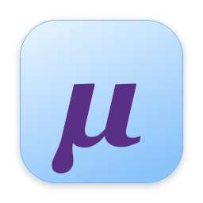

<p align="center"></p>

# Slide Viewer

A desktop whole-slide image viewer for **students** studying histology. Open a folder of slides,
browse them as thumbnails, zoom from the whole section down to single cells, adjust the stain, measure,
and place named pins and shapes. Pins and shapes are saved as `.ndpa` files, the format Hamamatsu
NDP.view2 uses, so they open in NDP.view2 and can be handed in for practical exams.

## Download

From [Releases](../../releases). The slide readers are bundled, so nothing else needs installing, and the
app updates itself from new releases (**Check for Updates…** in the app menu).

- **macOS** (Apple silicon and Intel, macOS 12+): the `.dmg`. Open it and drag the app to Applications.
  Signed and notarized.
- **Windows** (64-bit, Windows 10+): the `Windows-x64-setup.exe`. It installs for your user only, no
  admin rights needed. It isn't code-signed yet, so Windows may say it "protected your PC": click
  **More info → Run anyway**.

## Features

The full user guide is in [docs/help](docs/help/index.md); the same pages are built into the app (Help ▸ Slide Viewer Help, ⇧⌘/).

- Opens NDPI, SVS, whole-slide TIFF, MRXS, SCN, BIF, DICOM, Zeiss CZI and ordinary pictures
  ([file formats](docs/help/file-formats.md))
- Pick a parent folder: a collapsible tree of its subfolders with a thumbnail per slide, search by name,
  a badge on slides that have annotations, and **[ ]** to step through them
  ([getting started](docs/help/getting-started.md), [the slide browser](docs/help/browser.md))
- Overview map, scale bar, 1.25×–40× zoom presets, view rotation, focal planes (z-stacks) and PNG
  snapshots ([viewing](docs/help/viewing.md))
- Pins with free-text titles, rulers, freehand outlines, circles and rectangles, with undo/redo and an
  annotation list; autosaved to `<slide>.ndpa` next to the slide, NDP.view2-compatible, keeping anything
  it doesn't understand ([pins and shapes](docs/help/annotating.md), [measuring](docs/help/measuring.md))
- Exam answers: name pins as your instructor asks (`1`, `Q1`) and hand in the `.ndpa` file
  ([exam answers](docs/help/annotating.md#exam-answers))
- Gamma, brightness, contrast, saturation, hue, sharpen, grayscale and invert on the GPU; H&E and H-DAB
  stain separation; one-click Auto levels, Auto stain (detects H&E, IHC and special stains) and colour
  normalisation ([adjustments and stains](docs/help/adjustments-and-stains.md))
- Keyboard-first: [every shortcut](docs/help/shortcuts.md); and [troubleshooting](docs/help/troubleshooting.md)
  when something goes wrong

## Run

Needs Node and Rust. Fetch the slide libraries once (official prebuilt builds, pinned and checksummed):
`tools/fetch-openslide.sh mac` (or `windows`, from Git Bash), and `tools/fetch-libczi.sh mac` for Zeiss
`.czi` support.

```
cd app
npm install
npm run tauri dev      # run the app
npm run tauri build    # build an installer
```

## Tests

```
cd app && npx tsc --noEmit && npm run test:logic      # type check + logic tests (no slides needed)
cd app/src-tauri && cargo check && cargo test          # Rust
cargo test -- --ignored                                # also reads real slides, when they're on the machine
cargo run --example smoke -- path/to/slide.svs         # open a slide with the bundled libraries
```

`test:logic` covers coordinates, the NDPA reader and writer (round trip against real NDP.view2 files
in `test-data/` when present), filters, the folder browser, the viewer maths, and checks that every
help link and in-app help reference resolves. GitHub Actions run the type check, logic tests and web
build on every change, and build and smoke-test macOS (both chips) and Windows (including the
installed DLLs) when the native side changes.

Annotation files written here are also read by Micro Speed Grader, the sister app instructors use to
grade the exams; NDPA compatibility with NDP.view2 and with it is tested.

## Releasing

See [CLAUDE.md](CLAUDE.md#version-numbers-and-releases): `tools/release.sh <version> "<notes>"` builds,
signs and notarizes macOS, has GitHub Actions build Windows, and publishes the release the in-app
updater reads.

## License

MIT. Bundles OpenSlide (LGPL 2.1) and libCZI (LGPL 3.0) as separate libraries.
