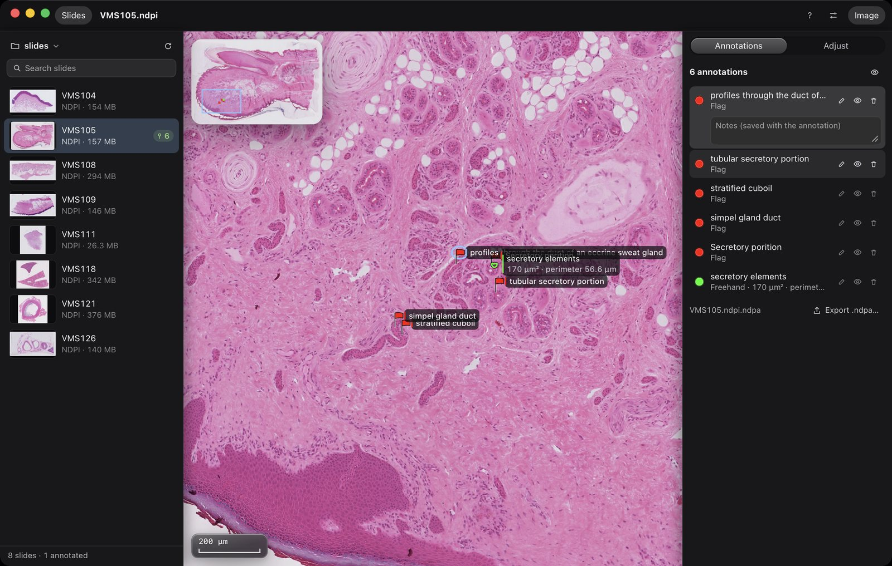
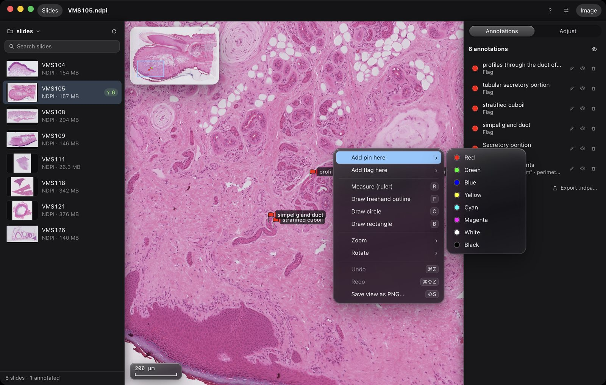
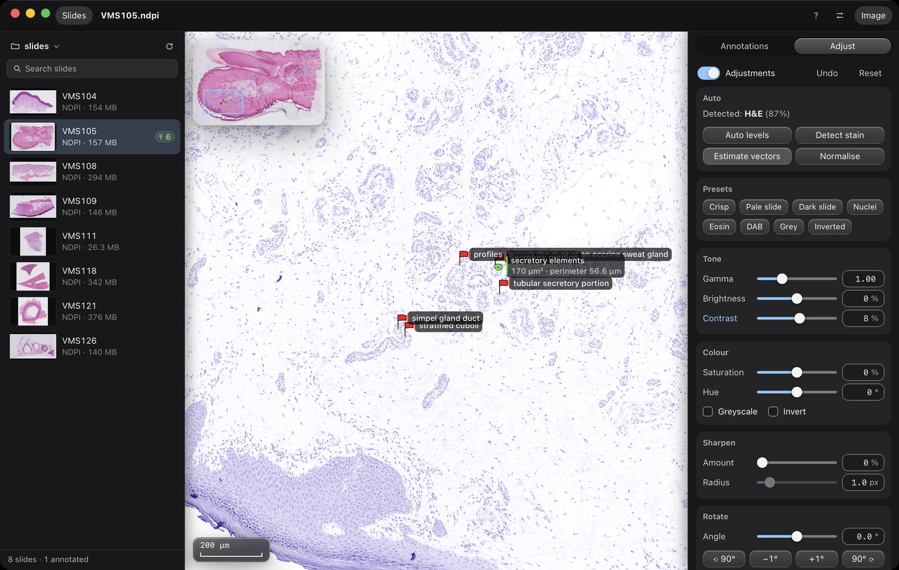

<p align="center"></p>

<h1 align="center">Slide Viewer</h1>

<p align="center">
  A whole-slide image viewer for <b>students studying histology</b>.<br>
  Open a folder of slides, zoom from the whole section down to single cells, adjust the stain, measure,
  and pin and label structures. Annotations save as NDP.view2 <code>.ndpa</code> files, so they open in
  NDP.view2 and can be handed in for practical exams.
</p>

<p align="center">
  <a href="../../releases/latest"><b>Download for macOS or Windows</b></a> ·
  <a href="docs/help/index.md">User guide</a> ·
  <a href="docs/help/shortcuts.md">Shortcuts</a>
</p>

<p align="center">
  
</p>

## Download

From [Releases](../../releases/latest). The slide readers are bundled, so there's nothing else to install,
and the app updates itself when a new version comes out (**Check for Updates…** in the app menu).

- **macOS** (Apple silicon and Intel, macOS 12+): the `.dmg`. Open it and drag Slide Viewer to
  Applications. Signed and notarized by Apple.
- **Windows** (64-bit, Windows 10+): the `Windows-x64-setup.exe`. It installs for your user only, so no
  admin rights are needed. It isn't code-signed yet, so Windows may say it "protected your PC": click
  **More info → Run anyway**.

## Pin it, name it, hand it in

**Right-click** anywhere on the slide to drop a pin or a flag in any colour right there, draw a ruler,
outline or shape, zoom to a magnification, or rotate the view. Type a title and press ↵. Every change
autosaves to `<slide>.ndpa` next to the slide, keeping anything NDP.view2 wrote that this app doesn't
use. For an exam, name each pin the way your instructor asks (`1`, `Q1`, …) and hand in that file:
[Micro Speed Grader](https://github.com/agadin/micro-speed-grader) reads it for grading.

<p align="center">
  
</p>

## See the stain

The **Adjust** tab has gamma, brightness, contrast, colour and sharpening, all on the GPU and live while
you pan. **Detect stain** recognises H&E, IHC (H-DAB) and special stains, **Estimate vectors** fits
colour deconvolution to the slide in front of you, and the stain separation shows the haematoxylin or
eosin layer on its own. **Normalise** evens out faded or over-stained slides, and **Undo** steps back
any of it. You can also rotate the slide, or tip it in perspective
([adjustments and stains](docs/help/adjustments-and-stains.md)).

<p align="center">
  
</p>

## Features

The full [user guide](docs/help/index.md) is also built into the app (**Help ▸ Slide Viewer Help**).
New here? Start with [getting started](docs/help/getting-started.md); if something isn't working, see
[troubleshooting](docs/help/troubleshooting.md).

- **Opens the formats courses use**: Hamamatsu NDPI and VMS, Aperio SVS, Philips, Huron and generic
  tiled TIFF, MIRAX, Leica SCN, Ventana BIF, Argos AVS, DICOM, Zeiss CZI and ZVI, Olympus VSI and OIR, Leica LIF, plus JPEG, PNG, BMP, WebP and flat TIFF
  pictures. Fluorescence slides (Olympus, Leica, Zeiss) show their channels combined in colour
  ([file formats](docs/help/file-formats.md)).
- **A folder of slides at a glance**: choose a parent folder to get a tree of its subfolders with a
  thumbnail per slide, search, a badge on annotated slides, and **[ ]** to step through them. Or open
  a single slide with **File ▸ Open Slide…** ([the slide browser](docs/help/browser.md)).
- **Viewing**: an overview map you can move and resize (**M** hides it), a scale bar in the corner of
  your choice, zoom from 1.25× to 40×, free rotation, focal planes on z-stacked scans, and PNG
  snapshots ([viewing](docs/help/viewing.md)).
- **Annotations**: pins and flags with free-text titles, rulers, freehand outlines with area, circles
  and rectangles; undo/redo; a list to jump between them ([pins and shapes](docs/help/annotating.md),
  [measuring](docs/help/measuring.md)).
- **Accessible**: everything works from the keyboard, including placing pins with a keyboard cursor
  (**X**); screen-reader labels and announcements; text up to 200%; high contrast; reduced motion and
  colour-blind-safe annotations ([accessibility](docs/help/accessibility.md)).
- **Tidy by default**: the tool bar and zoom bar are hidden until you want them (Preferences ▸ Viewing),
  and the side panels slide over the image rather than squeezing it.

## Build from source

Needs Node and Rust. Fetch the slide libraries once (official prebuilt builds, pinned and checksummed):

```
tools/fetch-openslide.sh mac      # or: windows (from Git Bash)
tools/fetch-libczi.sh mac         # Zeiss .czi support
cd app
npm install
npm run tauri dev                 # run the app
npm run tauri build               # build an installer
```

## Tests

```
cd app && npx tsc --noEmit && npm run test:logic      # type check + 2,500 logic tests (no slides needed)
cd app && npm run test:a11y                             # axe WCAG 2.1 AA audit + keyboard-only walkthrough
cd app/src-tauri && cargo test                          # Rust
tools/fetch-format-samples.py test-data/formats         # once: public sample slides, checksummed (~1.5 GB)
tools/check-formats.sh                                  # open every sample with the bundled readers
```

The logic tests cover coordinates, the NDPA reader and writer (round trip against real NDP.view2 files,
and an independent check that Micro Speed Grader's parser reads what this app writes), filters and stain
maths, the folder browser and the viewer maths, and check that every help link resolves. GitHub Actions
run them on every change and build and smoke-test macOS and Windows.

## Releasing

See [CLAUDE.md](CLAUDE.md): `tools/release.sh <version> "<notes>"` builds, signs and notarizes macOS, has
GitHub Actions build Windows, and publishes the release the in-app updater reads.

## License

MIT. Bundles OpenSlide (LGPL 2.1) and libCZI (LGPL 3.0) as separate libraries.
