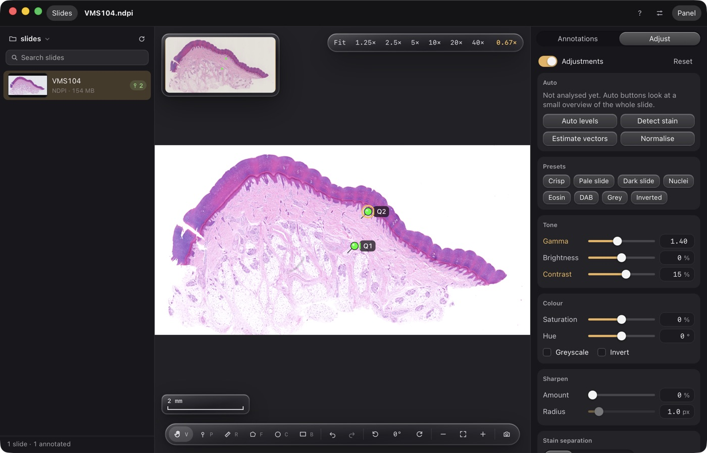

# Adjustments and stains

Slides scanned on different days, or stained in different labs, can look very different: too pale, too dark, too pink, too blue. The **Adjust** tab in the right panel changes how the slide looks on screen so the structures are easier to see. Adjustments never change the slide file or your annotations, and they don't affect what the grader sees.

Changes apply straight away, and panning and zooming stay smooth because the work happens on the graphics card. They're included in [snapshots](viewing.md#snapshot). Each slide keeps its own adjustments while the app is open, so you can switch slides and come back without losing them. A slide you haven't adjusted opens unchanged (unless an Auto step is set to run on open; see [Run automatically](#run-automatically)).

- Press **\\** on the slide, or flip the **Adjustments** switch at the top of the tab, to compare with the original image.
- **Undo** steps back the last change: a slider, a preset, or an Auto button such as **Normalise** or **Estimate vectors**. Press it again to go further back. **⌘Z** does the same while you're in the Adjust tab (on the slide, ⌘Z undoes annotations).
- **Reset** puts everything back (and **Undo** brings your settings back again).
- **Normalise** is a switch: click **Normalised ✓** again to turn it off.
- Double-click a slider or its label to put just that one back. You can also type a value in the box beside it.

## The sliders

| Slider | What it does |
| --- | --- |
| **Gamma** | Above 1 brightens the mid-tones, below 1 darkens them, while leaving black and white alone. Raise it to see into dark, dense tissue; lower it to bring out a pale stain. |
| **Brightness** | Makes everything lighter or darker. |
| **Contrast** | Spreads the tones apart (more contrast) or pulls them together. |
| **Saturation** | Makes colours stronger or greyer: −100% is grey. |
| **Hue** | Shifts every colour around the colour wheel. Useful when a slide is noticeably too pink or too purple. |

The **Greyscale** and **Invert** checkboxes turn the image grey or invert it (a dark background with light tissue, like a dark-field image, which some people find easier for spotting small dark nuclei).

When Auto levels is on, a **Levels on** chip appears; click its × to remove the levels again.

### Sharpen

An unsharp mask. **Amount** sets the strength, and **Radius** sets the size of the detail it enhances, in screen pixels. Small radii (about 1 px) crisp up nuclei, and large ones bring out bigger structures. A little goes a long way; too much makes noise and halos.

### Presets

One click sets a complete look: **Crisp**, **Pale**, **Dark**, **Nuclei**, **Eosin**, **DAB**, **Grey** and **Inverted**. A preset replaces the current tone and colour settings, but keeps Auto levels and normalisation.

## Rotate

Tilt the whole slide to line a structure up: drag **Angle** (−180° to 180°, in half degrees) or type a number, or use the **⟲ 90°**, **−1°**, **+1°** and **90° ⟳** buttons. **Reset** straightens it again. The overview map turns with the slide, and annotations stay where they are on the tissue (rotation is a way of looking, not a change to the slide or its `.ndpa`). The **,** and **.** keys turn 90°, and **⇧,** / **⇧.** turn by the small step.

### Perspective

**Tip forward** and **Tip sideways** (−60° to 60°) show the slide at an angle, as if you tipped the glass instead of looking straight down. It's a way of looking only. While the slide is tilted, panning and zooming work, but you can't place or edit annotations, and the scale bar is hidden because lengths differ across a tipped view. **Straighten** (also in the right-click menu) brings everything back. Opening another slide starts it straight.

## Stain separation

Histology stains are mixtures of dyes. Stain separation (colour deconvolution) splits the colours back into the dyes that made them:

1. Choose **H&E** or **H-DAB** (**Off** shows the slide as it is).
2. Choose **All** (the stains recombined) or a single stain, shown in its own colour:
   - **H&E**: **Haematoxylin** (nuclei, blue-purple) or **Eosin** (cytoplasm, collagen and muscle, pink).
   - **H-DAB** (immunohistochemistry): **Haematoxylin** (the blue counterstain) or **DAB** (the brown that marks where the antibody bound).

Showing only haematoxylin, for example, makes nuclei stand out clearly even in a heavily eosin-stained section.

Separation uses the standard (Ruifrok) stain colours unless you click **Estimate vectors** or type your own values in the table. **Reference** goes back to the standard colours.

## The Auto buttons

The Auto buttons look at a small overview of the whole slide. They only use the **tissue** (the empty glass around it is ignored), so a large white area doesn't skew the result. They take a second or two at most, and you can still adjust the sliders afterwards.

| Button | What it does |
| --- | --- |
| **Auto levels** | Sets the black and white points and a gamma from the tissue. The glass becomes white and pale or flat slides gain contrast. |
| **Detect stain** | Recognises H&E, H-DAB (immunohistochemistry) or a special stain (trichrome, silver, PAS, a single blue dye) and applies a mild matching preset. The readout shows the result, for example **Detected: H&E (88%)**. |
| **Estimate vectors** | Measures this slide's own dye colours (the *stain vectors*; the method is Macenko's) and uses them for stain separation, so separation works even when the slide is unusually pink or blue. |
| **Normalise** | Re-colours an H&E slide to a standard textbook H&E, so slides from different batches or labs look alike, or a faded or over-stained slide is rescued. It's meant for H&E; on other stains the result may look odd. |

The percentage is how sure the detection is. Below about 60% the slide is ambiguous: heavily eosin-stained muscle or bone, for example, looks very much like PAS. Treat a low-confidence result as a hint, and choose the stain yourself if it guessed wrong.

## Run automatically

In **Preferences ▸ Adjustments**, choose which Auto steps run by themselves the first time you open each slide (for example Auto levels on every slide). They're off by default. Normalisation runs automatically only on slides detected as H&E.
